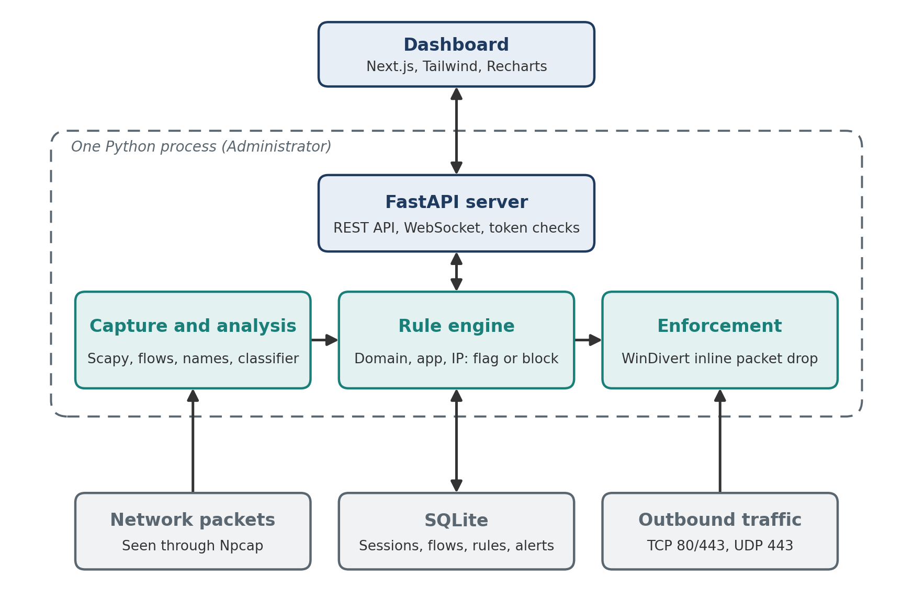
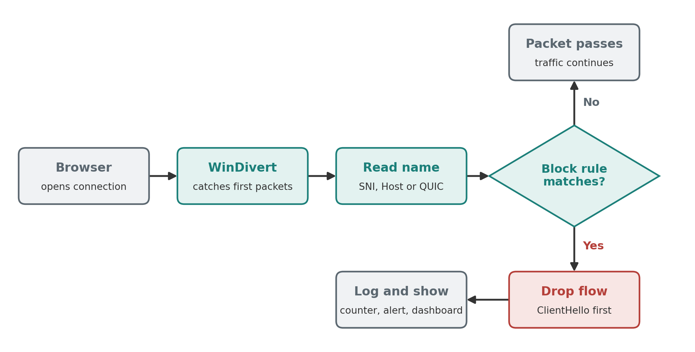

# Traffic Analyzer

A real-time network traffic analyzer and blocker for Windows. It shows which apps and websites a PC is using, live, **without decrypting any traffic**, and lets you block one with a single switch.

Names are read only from fields that are sent in the clear: the TLS SNI, the HTTP Host header, the QUIC Initial packet and DNS answers. Blocking is done inline with WinDivert, which drops every packet of a blocked flow before it leaves the PC.



## Features

- Names the site and app behind each connection (TCP and QUIC/HTTP3).
- Rules by domain, app or IP address, each set to flag or block. Block wins over flag.
- Inline blocking with WinDivert. No TCP reset race, and no need to shut down UDP 443 for every site.
- Rule changes apply to connections that are already open.
- Local dashboard with live traffic, blocked attempts and a per-rule status: working, leaking or waiting.
- History in SQLite (sessions, flows, rules, alerts).
- Local-only API with a per-run token and Origin/Host checks.

## How blocking works



## Requirements

- Windows with **Administrator** rights
- Python 3.12 (the version used in CI and Docker)
- [Npcap](https://npcap.com)
- Node.js, only if you want to rebuild the dashboard (the built version is included)

## Quick start

From an Administrator PowerShell in the project folder:

```powershell
.\run.ps1
```

This creates a virtual environment, installs the requirements and starts the server. Open <http://127.0.0.1:8000>.

To test a block: add a rule for `youtube.com` on the Rules page, reload YouTube (it should fail), then delete the rule and reload (it should load).

## Dashboard

| Page | What it shows |
| --- | --- |
| Overview | Capture status, summary cards, top apps, live feed of blocked events |
| Connections | Searchable table of live flows with the detected name and app |
| Apps | Traffic grouped by app |
| History | Past capture sessions and their flows |
| Rules | Add and delete rules, with working / leaking / waiting status |

## Project layout

```
trafficanalyzer/   Backend package
  server.py          FastAPI app, REST API, WebSocket, security checks
  analyzer.py        Flow tracking and name extraction
  flows.py           Flow and flow-table handling
  sni.py             TLS ClientHello and HTTP Host parsing
  reassembly.py      TCP segment reassembly for split ClientHellos
  quic.py            QUIC Initial decryption and ClientHello parsing
  dns_cache.py       DNS answer cache (fallback when no name is seen)
  classifier.py      Domain to app mapping
  rules.py           Rule engine (domain, app, IP; flag or block)
  divert.py          WinDivert inline blocking
  reset.py           TCP reset injection (fallback)
  enforce.py         Firewall rule helpers
  capture.py         Network interface selection
  db.py              SQLite storage
dashboard/         Next.js dashboard (static export in dashboard/out)
tests/             Automated tests
tools/             Benchmark and Wireshark validation scripts
docs/              Diagrams
run.ps1            Windows launcher
run_tests.py       Runs all tests
```

## Configuration

Set these as environment variables before starting.

| Variable | Default | Purpose |
| --- | --- | --- |
| `IFACE` | system default | Network interface to capture on (part of its name) |
| `API_TOKEN` | generated per run | Token for the API |
| `RETENTION_DAYS` | `30` | How long history is kept |
| `WINDIVERT` | `1` | Set to `0` to disable WinDivert and use reset injection only |
| `QUIC_SHIELD` | `1` | Fallback that blocks UDP 443 when WinDivert is not active |
| `ALLOWED_HOSTS`, `ALLOWED_ORIGINS` | localhost | Extra hosts or origins to accept |

## Tests

```powershell
python run_tests.py
```

Runs 7 test files (classifier, QUIC, blocking, capture, security, robustness, WinDivert logic). The WinDivert tests use fake packets, so they do not need the driver.

Other checks, which need a pcap file:

```powershell
python -m tools.validate_sni capture.pcap      # compare extracted names with Wireshark (needs tshark)
python -m tools.dns_check capture.pcap         # how often DNS names agree with SNI
python -m tools.expiry_check capture.pcap      # flow expiry must not change byte totals
python -m tools.benchmark                      # throughput and memory
```

## Results

- Domain extraction matched Wireshark on 192 of 192 TCP flows and 18 of 18 QUIC flows.
- Benchmark on the test PC: about 3,677 packets per second end to end, 1.1 KB of memory per flow, 0.22 ms to decrypt and parse a QUIC Initial.
- A YouTube block stopped 373 connections and the page loaded again once the rule was deleted.

## Limitations

- Protects only the PC it runs on.
- Needs Windows and Administrator rights for blocking.
- Sites using Encrypted Client Hello hide their name, so domain rules cannot match them.
- A connection opened before the program started is blocked only after it reconnects.
- Throughput on the capture path is limited by Scapy packet parsing (about 44 Mbit/s).

## Docker

The `Dockerfile` runs the dashboard and passive analysis on Linux. Blocking needs Windows (WinDivert), so it is not available there.

## References

- RFC 9001, Using TLS to Secure QUIC
- RFC 8446, TLS 1.3
- [WinDivert](https://reqrypt.org/windivert.html), [pydivert](https://github.com/ffalcinelli/pydivert), [Scapy](https://scapy.net), [Npcap](https://npcap.com)
